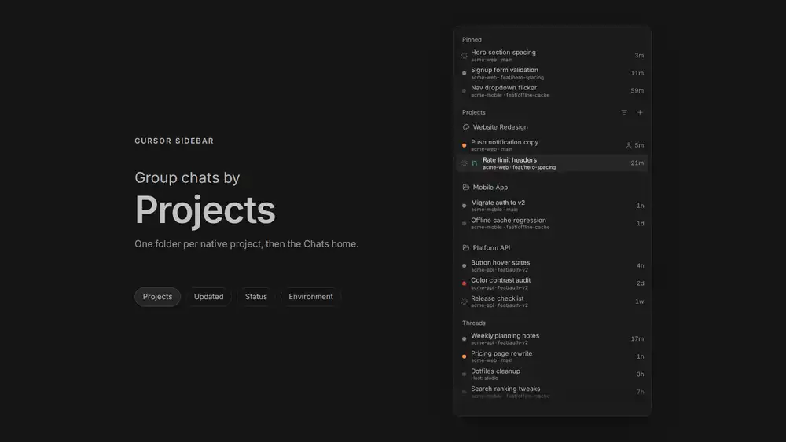

# Cursor Sidebar

A port of Cursor's sidebar to BB, with five view modes: group chats by project,
status, environment or date, or draw one flat list.

Chats nest under the chat that spawned them, pinned chats gather in one block,
and standalone chats file into folders. The view settings live in the plugin's
own database on the BB server, so uninstalling the plugin removes them and
leaves your threads alone.

## Grouping



Sample chats, grouped by Projects, Updated, Status and Environment. **None**
draws one flat list instead: no headings at all, pinned chats still first under
**Pinned**, child chats still nested, and the rows follow the conversation order
picked under **Ordering**. The [mp4 is here](docs/media/grouping-demo.mp4)
if your browser will not play the WebP.

## The toolbar and the headings

One fixed row sits above the thread list and never scrolls: the project switcher
on the left and the view menu trigger on the right. Section headings below it
carry no controls of their own; a heading is only a small muted label that folds
its block, and a project or folder heading keeps its glyph.

Every grouping uses the same sections. Pinned always comes first, then the
group's own headings (project names, dated buckets, statuses), then **Chats** for
standalone conversations. **None** has no sections at all: folders included,
every chat sits in one list, so only **Pinned** and the child-thread trees keep
a heading. There is no umbrella "Projects" or "Threads" heading,
and an empty heading is never drawn: a project with no visible thread is hidden
in Projects grouping, except the one picked in the switcher, which says
**No threads**.

## The view menu

| Control | What it changes |
| --- | --- |
| **Grouping** | Projects, Updated, Status, Environment or None. One at a time, never stacked |
| **Chat order** | By last activity, or by status |
| **Project order** | By hand, or by worst status and then by the project used most recently. Projects grouping only |
| **Group order** | Most recent first, or the grouping's own default order. Hidden under None, which has no groups |
| **Threads per group** | How many inactive chats a section previews: 5, 10, 20, 50 or All. The default is 10 |
| **Show** | Updated time, environment, branch, machine, the pull request mark and project icons on rows outside Projects grouping |
| **Status filter** | Needs your input, Failed, Working, Unread, Idle |
| **Age filter** | Today, Yesterday, Last 7 days, Last 30 days, Older |
| **Environment filter** | Which environments appear, including chats with none |
| **Expand All / Collapse All** | Every section and group at once |
| **Mark All as Read** | Every loaded chat that is unread |

The three order controls live under Ordering and the three filters live under
Filters. None offers only the conversation order, since it has no sections to
arrange.

**Threads per group** bounds every section in every grouping — project sections,
date, status and environment groups, the flat None list, Chats — and the child
chats nested under a parent. Each group previews one page and **Show N more**
reveals the next, where N is the chosen page. A family counts once,
and a chat that is working, needs your input, selected or pinned always shows
whatever the limit. **All** drops the limit and the button.

The menu button shows a warning mark when a view change has not reached the
server. The notice inside the menu has a Retry button.

## Project switcher

The left side of the toolbar row. It reads **All projects**, one project's name,
or **N projects**, and wears that project's icon when it has one. The chevron
sits straight after the label; the row is plain, with a hover background like
the sidebar's other rows. Click it for every project, All projects first.
**New project…** is the last item, under a separator, and opens BB's own Add
project dialog.

Picking one project narrows the list in every grouping, and under Projects
grouping the row drops that project's heading: its chats read as one flat list
instead of a section you can fold away. Picking **All projects** brings every
group back. The switcher only appears when there are two or more projects to
switch between; with fewer, the toolbar keeps the view menu on the right.

## Project icons

Open a project heading's **Actions** menu and choose **Set icon…**. The dialog
offers a searchable glyph grid, an emoji grid (paste any emoji), or a
one-or-two-letter monogram, each with an 18-colour palette and a live
preview. **Upload image** uses your own picture and keeps PNG transparency; the
image is shrunk to 64px before it is saved. **Reset to default** returns the
folder.

Chats can set icons too, from a shell:

```sh
bb cursor-sidebar icon set ./icon.png      # a PNG, under 192KB and 1024px a side
bb cursor-sidebar icon glyph Rocket        # a built-in glyph; --list shows them
bb cursor-sidebar icon clear               # back to the folder
bb cursor-sidebar icon get                 # what the project wears now
```

Run from a chat, these act on that chat's project. Anywhere else, add
`--project <id or name>`. The PNG is read on the BB server's machine.

## Mobile

Touch uses the same list. A phone has no hover, so gestures carry the actions
instead.

| | Do this |
| --- | --- |
| Open a chat | Tap the row |
| Fold a project | Tap its name |
| Pin a chat | Swipe the row left |
| Archive a chat | Swipe the row right |
| Move a chat or a project | Hold until the row lifts, then drag |
| Open the actions menu | Hold until the row lifts, then let go without moving |
| Reorder a project without dragging | Hold the heading, then pick Move up or Move down. Project order Manual only |

A swipe has to travel 72px to commit. Anything shorter eases the row back.

While a row is lifted, or a swipe is locked sideways, the plugin holds the list
still so the gesture wins over the scroll. A plain vertical drag still scrolls
the list.

Letting go of a lifted row without moving opens its menu, and that menu holds
Expand children or Collapse children for a chat that has any. A lifted drag
drops where you leave it: a folder heading files the chat, the middle of another
chat in the same project nests it, and a project heading between two others
reorders the projects.

The pin and archive icons stay hidden on touch. Nothing reveals them without
hover, and the 44px targets a phone needs do not fit in a row, so a swipe or
the actions menu does that work instead.

## Workspaces

With the [Workspaces](https://github.com/wy3z/bb-plugin-workspaces) plugin
running, the chats of one workspace nest under its first chat, the way spawned
chats nest under their parent, and that row shows the workspace's name when it
has one. Top-level chats that share a worktree count as one workspace too.
Without that plugin nothing changes.

## Requirements

BB 0.48.1 or newer, with plugin SDK 0.6.104 or newer. The plugin fills BB's
experimental thread-list slot, which replaces BB's own thread list. Turn it off
with `bb plugin disable cursor-sidebar`.

## Install

```sh
bb plugin install git:https://github.com/wy3z/bb-plugin-cursor-sidebar.git
bb plugin reload cursor-sidebar
```

## Development

```sh
npm run typecheck          # tsc --noEmit
npm run build              # bb plugin build writes dist/
bb plugin reload cursor-sidebar
```

The realtime channel names shared with the backend live in `src/channels.ts`.
Frontend modules must import them from there, and may only `import type` from
`src/server.ts`. The backend imports `@get-bb/plugin-sdk`, which is a dev
dependency: a git install prunes dev dependencies and the host only hands the
SDK to the server bundle, so a value import of `./server` from frontend code
drags the backend into `app.js` and fails `bb plugin install git:...` with
`Could not resolve "@get-bb/plugin-sdk"` — while still building on a machine
that has the SDK installed.

## License

MIT. Portions adapted from bb-plugin-thread-inbox. See
[THIRD-PARTY-NOTICES.md](THIRD-PARTY-NOTICES.md).

## Compact navigation

An optional Zeron-style sidebar header: back, forward and New thread on the left, a menu of every navigation destination on the right, and no navigation rows. BB's own back/forward buttons are hidden while it is active. Pick **Compact** under Settings → Appearance.
